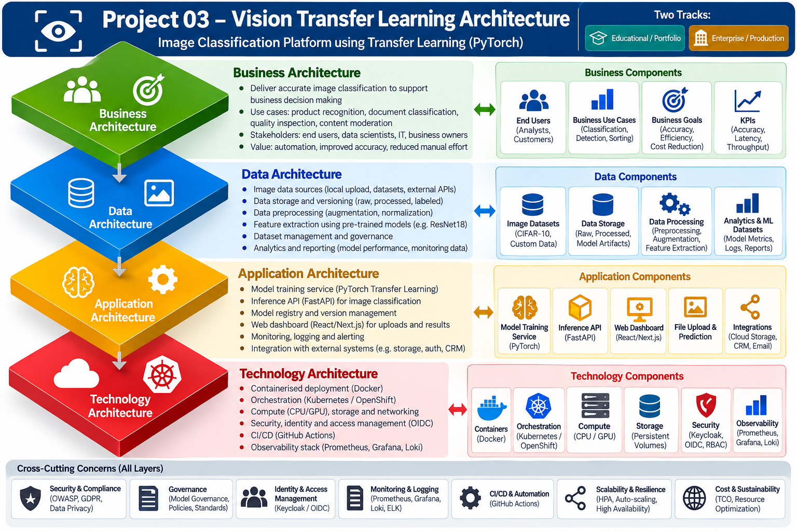
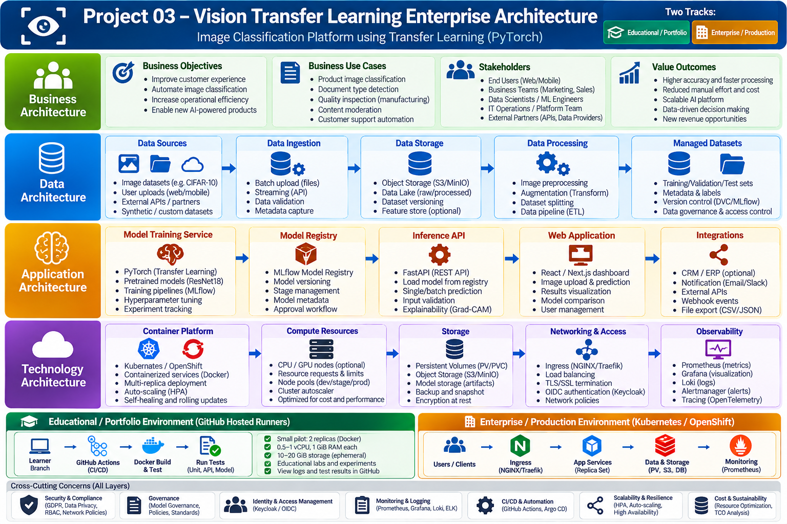
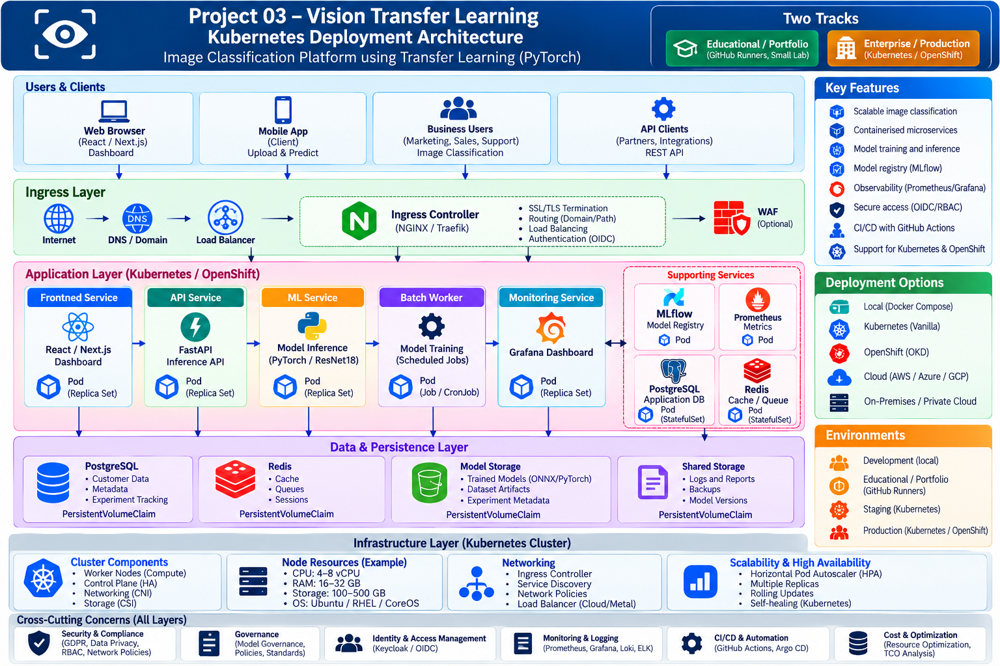

# Project 03 — Vision Transfer Learning

**Two tracks:** Educational / Portfolio and Enterprise / Production reference architecture.

Build an image classifier using PyTorch and pretrained torchvision ResNet18, with a reproducible training/evaluation pipeline, FastAPI inference, Docker, Kubernetes/OpenShift and cloud-neutral deployment guidance.

> **Status:** Project scaffold and GitHub CI validated. Synthetic CPU training and generated diagrams are available; real-dataset experiments, local Docker execution, GPU benchmarks and enterprise production deployments remain unverified.

## Learning track

1. Fork this repository and create a branch `learner/first-lab`.
2. Enable GitHub Actions in your fork after reviewing the workflows.
3. Run the **education-smoke** workflow using a CPU-only synthetic-image smoke test (no paid GPU required).
4. Run tests, inspect logs and document model accuracy on a licensed real dataset separately.
5. Follow [the learner lab](docs/learning/GITHUB-RUNNERS-LAB.md).

## Enterprise track

Reference designs cover TOGAF 10, ArchiMate-inspired viewpoints, C4, model lifecycle governance, security, observability, scalable inference and cloud-neutral infrastructure. **Architecture documentation is not evidence of a production deployment.**

## Step-by-step learner labs: local or GitHub-hosted

Choose **either** a local Docker Desktop/Rancher Desktop environment or GitHub's standard hosted runners. Both use **synthetic images and random-initialized ResNet18 weights** for functional testing, not real model accuracy.

### Option A — Local Python + Docker Desktop or Rancher Desktop + Postman

1. Fork the repository, clone your fork, and create a `learner/local-lab` branch.
2. Install Python 3.12, Git and **Docker Desktop** or **Rancher Desktop**. On Rancher Desktop choose the **dockerd (moby)** engine.
3. In the repository root, train a CPU smoke model and run tests:

   ```bash
   python3.12 -m venv .venv
   source .venv/bin/activate
   python -m pip install -e ".[dev]"
   python scripts/train_smoke.py
   pytest -q
   ```

   On Windows PowerShell, use `py -3.12 -m venv .venv` and `.venv\\Scripts\\Activate.ps1`.

4. Start the API with the committed Compose file:

   ```bash
   docker compose build
   docker compose up -d
   docker compose ps
   ```

5. Test `http://127.0.0.1:8000/health/live`, `/health/ready` and `/docs` in a browser.
6. In **Postman**, create **POST** `http://127.0.0.1:8000/predict` → **Body → form-data** → key **file** → type **File** → choose a JPEG/PNG image under 5 MiB → **Send**. Expect `classes`, `probabilities` and a synthetic-model warning in the JSON response.
7. Record logs and resource usage (`docker stats --no-stream`), then stop with `docker compose down`.

**Full illustrated command-by-command guide:** [Docker Desktop / Rancher Desktop / Postman local lab](docs/learning/LOCAL-DOCKER-POSTMAN-LAB.md).

### Option B — GitHub-hosted runner (no local Docker needed)

1. Fork this public repository to **your GitHub account**.
2. In your fork, create branch `learner/vision-lab-01` from `main`.
3. Review `.github/workflows/ci.yml` and `.github/workflows/education.yml`; open **Actions** and enable workflows in your fork if prompted.
4. Open **Actions → education-smoke → Run workflow**; choose your learner branch and start the run.
5. Inspect synthetic training logs, test results, runner disk space and workflow outcome.
6. Edit the model code on your branch, commit, and check the automatically triggered **ci** workflow.
7. Optionally open a pull request from your learner branch to **your fork's main**, and attach the run URL and test observations to your portfolio.

**Full guide:** [GitHub runner educational lab](docs/learning/GITHUB-RUNNERS-LAB.md).

**Billing:** Standard GitHub-hosted runners for eligible public repositories are generally free under GitHub's published policy; verify your account's Actions billing/limits. These runners are ephemeral and do not provide permanent hosting or guaranteed GPUs.

### Enterprise / Production reference

See [deployment guide](docs/DEPLOYMENT.md), [Kubernetes manifests](deploy/kubernetes/) and [OpenShift Route](deploy/openshift/route.yaml). These are starter artifacts and require an approved model, prepopulated storage, security gateway and operational validation. A single laptop or GitHub runner is **not** a production HA cluster.

## API

- `GET /health/live` — process liveness
- `GET /health/ready` — model readiness
- `POST /predict` — upload an image file and receive top class probabilities


## Architectural Diagrams & Infographics

### Enterprise architecture — TOGAF-aligned overview


### Vision transfer learning — detailed platform architecture


### Kubernetes / OpenShift deployment reference


[Editable Mermaid, SVG and PNG architectural diagrams](diagrams/source/) — seven diagrams with all three file formats. Infographics show conceptual enterprise capabilities; not all illustrated services are implemented in the starter application.

## Documentation

- [Local Docker Desktop / Rancher Desktop / Postman lab](docs/learning/LOCAL-DOCKER-POSTMAN-LAB.md)
- [GitHub-hosted runner lab](docs/learning/GITHUB-RUNNERS-LAB.md)
- [TOGAF 10 architecture](docs/architecture/TOGAF10-ARCHITECTURE.md)
- [ArchiMate-inspired viewpoints](docs/architecture/ARCHIMATE-VIEWPOINTS.md)
- [C4 diagrams and editable Mermaid](diagrams/source/)
- [Capacity planning](docs/infrastructure/CAPACITY-PLANNING.md)
- [TCO](docs/COST-TCO.md)
- [Datasets and licensing](docs/datasets/DATASETS.md)
- [Security](docs/security/SECURITY.md)

## Safety and licensing

Use public datasets only under their own licenses. Do not commit personal images, datasets, secrets, model weights or generated artifacts. Pretrained torchvision weights may download from the internet when enabled; the offline smoke lab uses random initialization and synthetic inputs and **does not establish real-world accuracy**.

## License

MIT for project source code; third-party datasets and pretrained weights have separate terms.
